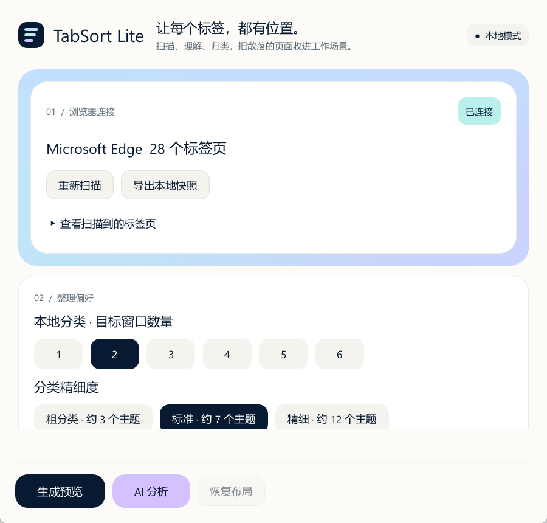

# TabSort Lite

[](https://github.com/chenruixu728-wq/tabsort-lite/actions/workflows/ci.yml)
[](https://github.com/chenruixu728-wq/tabsort-lite/releases/latest)
[](LICENSE)

**Local-first tab organizer for Microsoft Edge on Windows x64.** It scans connected Edge profiles, groups tabs by topic, previews a layout across 1–6 windows, and restores the previous layout from a local snapshot. AI regrouping is optional and talks only to the Chat Completions endpoint you configure.

**本地优先的 Windows 标签页整理工具。** 读取已连接的 Edge 配置，按标题和网址归类，预览 1–6 个窗口的整理结果，用本地快照恢复布局；也可选接入 DeepSeek 或兼容接口做 AI 再分组。桌面程序 1.0.0，配套连接扩展 0.2.0。



## 下载

从 [Releases](https://github.com/chenruixu728-wq/tabsort-lite/releases/tag/v1.0.0) 下载 **`TabSortLite-Edge-1.0.0.zip`**（约 49 MB，解压即用，含 EXE、扩展、模型和 ONNX Runtime）。

```text
SHA-256  37c8f4277e206bdeaf907bb680b2e6d9694b67acc12054b0cb0574a9d4da71aa  TabSortLite-Edge-1.0.0.zip
```

完整校验值（含包内 EXE）见 [TabSortLite-Edge-1.0.0-SHA256.txt](https://github.com/chenruixu728-wq/tabsort-lite/releases/download/v1.0.0/TabSortLite-Edge-1.0.0-SHA256.txt)。`-Source.zip` 和本仓库源码都不含 EXE 与模型：模型和运行库由 `scripts/package.ps1` 下载并按 SHA-256 校验。

> EXE 尚未代码签名，Windows 可能提示「未知发布者」：点「更多信息」→「仍要运行」。解压后请保持 `TabSortLite.exe` 与 `models\` 同级，单独移动 EXE 会因缺少模型而无法分类。

## 首次连接

1. 解压整个文件夹，双击 `TabSortLite.exe`，点击「注册 Edge 连接」。注册以当前 Windows 用户身份完成。
2. 在 Edge 打开 `edge://extensions`，开启「开发人员模式」，选择「加载解压缩的扩展」，选中解压目录里的 `extension` 文件夹。
3. 点击 Edge 工具栏或扩展菜单中的 **TabSort Lite Connector**。连接后，EXE 会显示标签页数量。以后打开 EXE 时，扩展约每 30 秒自动尝试连接，点击图标可立即重试。

移动程序文件夹后，需要重新注册连接并从新位置加载扩展。本发行包使用本地加载的连接扩展。使用包内的模型进行分类时，系统需有 Microsoft Visual C++ x64 运行库。

从 0.3–0.7.2 版升级时，先关闭旧版，再用正式版的 `TabSortLite.exe` 替换原目录的同名文件。从更早的版本升级时，也要覆盖 `extension` 文件夹，并在 `edge://extensions` 重新加载 TabSort Lite Connector。

## AI 分析与重新分组

1. 点击「AI 分析」。选择 DeepSeek 并输入自己的 API 密钥，或填写本机支持 JSON 输出的 Chat Completions 接口和模型名。
2. 勾选想拆开重新分析的已有组，或点击「全选」选中所有可拆分组。未勾选的组按整体安排窗口。含受保护页的原组留在原处。
3. 点击「确认发送并分析」。模型会按内容建议 1–6 个一级窗口和合适的标签组数。检查预览后再点「确定整理」。

AI 优先根据标题、用途提示和同批页面中的项目线索匹配主题。通用标题也会参与分析。缺少可用内容，或模型找不到合理归属的页面，归入「无法确定」。漏分或重复分配的页面另列入「待确认 · AI 未归类」。程序会核对每个可移动标签页恰好出现一次。

AI 模式发送标题、用途提示和临时编号。未拆分的原组只附组名和最多 4 个标题样本。请求没有网址字段、正文或 Cookie，标题本身仍可能含私人信息。密钥只保留在当前程序内存。远程服务可能计费。每次分析一个 Edge 配置，最多 600 个条目，未拆分的原组按一个条目计。

## 整理和恢复

- 选择窗口数量和分类精细度，点击「生成预览」。窗口显示一级工作场景和组数，标签组名称概括页面用途和可识别的共同主题。分类依据标题、搜索词和网址路径，本地推断。确定后程序先保存快照，再移动现有标签页和创建原生标签组。
- 已有手动组整组迁移，保留名称、颜色和组内顺序。固定页、发声页、识别出的在线编辑器、浏览器内部页及与其同组的标签页留在原处。无痕窗口不扫描。
- 重复网址只做标记。存在多个 Edge 配置文件时，每个配置文件独立规划和整理。主题不足时，实际目标窗口数会在预览中显示。
- 「恢复布局」使用每个配置文件最近一次整理前的快照。优先移动原标签页，必要时重新打开原网址。页面内存、未提交内容和滚动位置无法保证恢复。
- 本地快照包含原始网址和标题，保存在 `%LOCALAPPDATA%\TabSort Lite`。可在关闭应用后删除不再需要的快照。模型和分类在本地运行。
- 本发行包采用精简词表的 multilingual-e5-small INT8，主要针对中英文混合标签页。其他语言的分类质量尚未验证。

## 从源码构建

需要 Windows x64、Rust（版本由 `rust-toolchain.toml` 固定为 1.99.1，rustup 自动安装）以及 MinGW-w64 链接器（`gcc` 14+）。仓库使用 `x86_64-pc-windows-gnu` 目标，因此不需要 Visual Studio。打包脚本还需要 Python 3.12（压缩模型、下载 ONNX Runtime）和 Node.js 18+（测试与基准）。

```powershell
powershell -ExecutionPolicy Bypass -File scripts/package.ps1
node scripts/test-edge.mjs
node scripts/benchmark.mjs
```

`package.ps1` 会下载 E5 模型与 ONNX Runtime、压缩词表、编译 release 版本，并在 `dist/` 生成完整运行包、源码包和 SHA-256 清单。测试脚本使用独立 Edge 配置和本地测试页；AI 接口流程用本机模拟服务验证。基准脚本的 274 页样本为人工构造，分类指标仅描述该样本。

CI 在 `windows-latest` 上执行 `cargo build --release --locked` 和 `cargo test --release --locked`。端到端脚本需要本机安装 Edge，未纳入 CI。

## 项目结构

```text
src/        桌面程序：界面、语义模型、规划器、原生消息与恢复
extension/  Edge Manifest V3 连接扩展
scripts/    打包、端到端测试、基准
docs/       截图等文档资源
```

## 冻结文件

发布目录包含完整运行包、源码快照及 SHA-256 校验文件。源码快照包含 Cargo.lock 和构建脚本，模型与运行库随完整运行包保存。1.0.0 的后续修正使用新的版本号发布。

当前 EXE 尚未进行代码签名，扩展采用 Edge 开发人员模式本地加载。上架商店时需要验证商店分配的扩展 ID 和 Native Host 白名单。

## 许可

以 MIT 许可证发布，见 [LICENSE](LICENSE)。内置的 multilingual-e5-small 与 ONNX Runtime 同为 MIT，许可文本随发布包提供。
